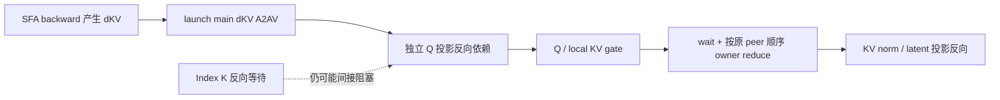

# DSA CP、算子与反向调度实验草稿

这里保存 DSA 负载均衡草稿中的可复现实验。正常训练配方仍使用模型目录的
[DSA CP 实现](../../../hyper_parallel/models/deepseek_v32/README.zh.md)；导入本目录不会开启任何实验。
实验涉及私有 CP 辅助函数，API 变化后需要重新核对。以下 Python 原型不适用于并发 forward、静态图、FSDP 或重计算；这些组合尚未验收。

## 1. 草稿中包含什么

| 代码 | 改动 | 当前结论 |
|---|---|---|
| `runtime_experiments.py` 的 `PendingGradient` / `_LatentGradientGate` | main latent KV 的反向 A2AV 先 launch，到 Q 投影依赖完成的 gate 再 wait 和 owner reduce | 算法值不变；单独延迟 wait 尚无稳定整链收益 |
| `_ProjectionExperiment` | 主 Q 投影与吸收 BMM 放到独立 NPU stream，明确输入依赖、输出等待及 storage 生命周期 | 部分 rank 能覆盖通信，最慢 rank 仍受 SFA backward 限制 |
| `partial_worker_rope` | 调用已有 `inplace_partial_rotary_mul`，包含 half/interleave 转换及系数 dtype 适配 | 默认 half 配对下更慢；非默认 interleave 情形可作对照，不默认开启 |
| `patches/sfa_grad_scatter_gate.patch` | ops-transformer SFA Grad 的 host tiling 分支实验 | H128 样本有收益，需单独编包和扩大算子验收；不替换设备 kernel 数学 |
| `check_absorbed_math.py` | 固定 TopK 的 FP64 吸收/非吸收输出和六组梯度对照 | 数学参考，不是非吸收式 NPU 训练实现 |
| `benchmark.py` / `check_partial_rope.py` | 数据输入、精度、性能、显存与可选 profile 入口 | 手动运行，不加入无 NPU 的门禁 UT |

`dsa_experiment(...)` 通过作用域内的替换接入原型，退出即恢复；不使用源码字符串替换或 `exec` 改写函数。
请把同一个模块的完整 forward 和 backward 放在该作用域内，并保证所有 CP rank 的实验选项一致。
当前只对一次 forward 执行一次 backward；不支持保留图后再次反向或 activation checkpoint 重放。
默认训练代码的配置和数值路径没有因为导入实验代码而改变。

## 2. 依赖和数据

先按 [DSA 算子安装说明](../../../hyper_parallel/components/functional/README.md#deepseek-v32-dsa)
准备 PyTorch、torch-npu、CANN、`cann_ops_transformer`，从本仓库执行 `pip install -e .`。
已有实测环境为 910B3、PyTorch/torch-npu 2.10、CANN 9。partial-RoPE 实验还需要扩展导出
`inplace_partial_rotary_mul`；缺失时直接报错，不静默回退。

CP 示例读取用户提供的 `.npz`，两个字段为：

- `tokens`：一维整数 token 数组。
- `boundaries`：按顺序排列的全局文档累计结束位置；可为自然文档长度。

`--global-tokens` 从样本起点截取指定长度，若末文档被截断则以截取终点收尾；总 token 数需能被 CP 数整除，
**每篇文档无需整除 CP 数**。脚本用固定种子的随机 embedding 把真实 token 转成 hidden：保留真实文档分布，
但不是加载预训练权重的完整模型训练，也不是收敛验证。不发布原始数据或机器路径。

## 3. CP 调度实验

从仓库根目录运行，例如：

```bash
python -m torch.distributed.run --standalone --nproc_per_node=4 \
  --module examples.torch.dsa.benchmark \
  --data /path/to/packed_tokens.npz --output /path/to/results/baseline \
  --global-tokens 65536 --heads 128 --qr 1536 --mode greedy \
  --experiment baseline
```

支持以下互相独立的 `--experiment`：

- `baseline`：当前 DSA CP。
- `deferred-main`：仅延迟 main latent KV 梯度的 wait。
- `q-stream`：仅将 Q 投影和吸收 BMM 放到独立流。
- `q-stream-deferred`：两者组合。
- `partial-rope`：仅替换无梯度 worker 的 RoPE，owner Indexer/KL 不变。

脚本固定 main/Index K 为 A2AV，以隔离调度变化；`--mode` 选择 none/zigzag/greedy/hybrid。
默认 hidden256、主头32、qr128 是快速功能形状，**不能用它估算完整宽度模型的收益**。
性能比较应同时固定形状、数据、均衡策略、确定性与运行环境，并记录重复样本。

加 `--check` 会先跑同配置 baseline，再跑实验，严格比较完整输出、整数 TopK 列表、输入梯度和全部非空参数梯度。
该模式开启确定性，包含 CPU 校验，**不报告性能**。性能模式关闭确定性，默认预热2次、测5次。
JSON 中提供前向、反向、整链耗时和峰值 allocated。整体临界时间应先对每轮取 rank 最大值，再对多轮统计；
不要只挑收益最大的 rank。`--profile-rank 1` 可额外记录一次 rank1 的 trace，其他 rank 同步执行该额外步。



这张图表示实验希望延迟的消费边界，不保证通信已被完全覆盖。同一 CP communicator 的提交顺序仍存在，
后续 Index K wait 可能排在 main KV 后面；Q RoPE 与吸收 BMM 的梯度也要汇合。
只把某个 `wait` 移走并不自动增加临界路径上的独立计算。

## 4. worker partial-RoPE

```bash
python -m examples.torch.dsa.check_partial_rope --output /path/to/partial_rope.json
```

默认检查5种 Q 长度、half/interleave 两种输入约定、BF16/FP32 两种系数 dtype，共20组。
严格比较完整输出，并检查输入没有被原地修改；耗时包含布局变换，不只测内部融合算子。

DSA 默认旋转 Index Q 的 D128 **前64维**，使用 half 配对。实测 910B partial 算子支持 interleave，
所以默认 half 需要输入重排和输出恢复。这些拷贝会抵消融合收益。
FP32 cos/sin 先按现有 owner 算子的规则转为 query dtype；省略这一点曾出现最大0.03125差异。
这个函数只用于 `no_grad` 的选择 worker，不应替换需要反向的 owner RoPE。

## 5. SFA Grad 算子侧实验

补丁适用于 [ops-transformer](https://gitcode.com/cann/ops-transformer) 中的
`attention/sparse_flash_attention_grad/op_host/arch22/sparse_flash_attention_grad_tiling_bs1_basic.cpp`。
历史构建使用源码导出目录，没有可核实的 Git commit，所以提供
[`patches/source.json`](patches/source.json) 的原始文件 SHA256，不声称适用于任意最新版本。
补丁的上游上下文遵循 ops-transformer 的 CANN Open Software License；Hyper 的 Python 原型沿用仓库许可证。

先核对源码，再在**独立源码和 vendor 环境**中应用；不覆盖常用训练包：

```bash
# 位于 ops-transformer 源码根目录，HP_SOURCE 指向此 Hyper 仓库。
sha256sum attention/sparse_flash_attention_grad/op_host/arch22/sparse_flash_attention_grad_tiling_bs1_basic.cpp
git apply --check "$HP_SOURCE/examples/torch/dsa/patches/sfa_grad_scatter_gate.patch"
git apply "$HP_SOURCE/examples/torch/dsa/patches/sfa_grad_scatter_gate.patch"

# 此源码快照支持的构建入口；并行度按本机资源选择。
bash build.sh --pkg --soc=ascend910b --vendor_name=dsa_scatter_experiment \
  --ops=sparse_flash_attention_grad -j"${BUILD_JOBS:-8}"
```

完整 `--pkg` 构建包含匹配的 kernel bin。历史实验为加快构建，使用 `--jit` 只重编 host 并在隔离副本中复用同源码的 kernel bin；
`--jit` 自身不包含 kernel bin，不能把它当成完整算子包覆盖默认安装。
随后按该版本 ops-transformer 的安装说明安装到独立 runtime，并让试验进程的
`ASCEND_CUSTOM_OPP_PATH` 和 `LD_LIBRARY_PATH` 指向同一实验 vendor。
官方源码版本不同可能改变安装方式；不混用新 host tiling 与不匹配的 device kernel 二进制。
Hyper 的 Python 导入路径不变，补丁也不是一个可 `pip install` 的 Python 包。

补丁提供进程级诊断变量 `DSA_SFAG_SCATTER_OVERRIDE`：

| 值 | 行为 |
|---|---|
| 未设置 / `auto` | 保留原分支判断 |
| `off` | 非确定性路径禁用优化 scatter，作为对照 |
| `on` | 非确定性、合法正长度、`1<=N1<=128`、`selectedBlockSize=1` 时允许实验 scatter |

确定性路径的保护保持在实验分支之前。这里只研究原有 device kernel 的 dispatch 门槛，不改变 attention 公式。
`on` 绕过部分原形状阈值，**不是已验证的通用性能规则**。需要按形状单独验证梯度和 workspace。
用独立进程分别运行 `auto` / `on` 的 benchmark；不能在同一进程切环境变量冒充配对，因为 tiling 缓存可能复用。
正常 vendor 不认识这个变量，即便设置也不会切换；必须确认加载的是补丁构建，不能仅看环境变量判断。

## 6. 已有证据，不能扩大外推

以下是同源原型的历史测量，不等于草稿中所有配置重新跑过，更不是完整模型加速承诺。

| 实验 | 观测 |
|---|---|
| SFA backward，Q8192/K8587、H128、5段TND、TopK2048 | 114.85→103.41ms，额外allocated约3962→3593MiB |
| 上述原生完整梯度 | dQ/dQ-RoPE逐位相同；dK相对L2约2.73e-5、dK-RoPE约2.97e-5；非确定性归约需与基线重复波动和FP64参考一起判断 |
| SFA scatter 放回 CP4、global64K/local16K、H128、qr1536 attention 前后向 | 517.14→501.22ms，峰值allocated18266.96→17860.28MiB；独立进程相邻运行，非交错配对 |
| 仅延迟 main wait | 516.75→517.32ms，没有稳定整链收益 |
| Q独立流 / 与延迟wait组合 | 快rank可覆盖约18ms等待，但组内最大耗时517.14→517.91/518.81ms |
| partial适配，Q8192、H64、D128，默认half | 当前约0.74ms，带重排约2.86ms；不应默认替换 |
| 同形状非默认interleave | 约2.34→1.86ms；需要确认训练的实际旋转约定 |

SFA 梯度对照用真实 packed 几何与构造的合法索引、随机BF16 Q/K；单层CP实验用真实token经随机embedding。
SFA分支尚需更多形状、重复ID热点、训练步数及完整模型验收；反向实验尚需FSDP、重计算与跨节点验收。

未完成工作、优先级和下一步验收见 [后续优化计划](后续优化计划.md)。

## 7. 本次整理后的复核（2026-11-17）

- CP2、global8K、9篇真实文档、hidden256/qr128/H32、greedy+A2AV：`deferred-main` 与
  `q-stream-deferred` 各自和baseline比较，2种实验×2rank×14项，共56项输出、TopK列表、输入/参数梯度逐位一致。
- worker partial-RoPE的20组完整输出和输入不变检查通过。Q8192：默认half约0.73→2.86ms，interleave约2.35→1.85ms，
  说明默认half仍不适合替换；此结果不作为完整attention提速结论。
- FP64吸收/非吸收参考的输出和6组梯度通过，最大绝对误差约1.87e-14。
- 新实验Python代码pylint、文档catalog、链接/空白检查通过；SFA补丁对记录的源码通过 `git apply --check`。
  本次未重新编译SFA实验包，SFA性能/梯度结果沿用前述历史原型测量。
